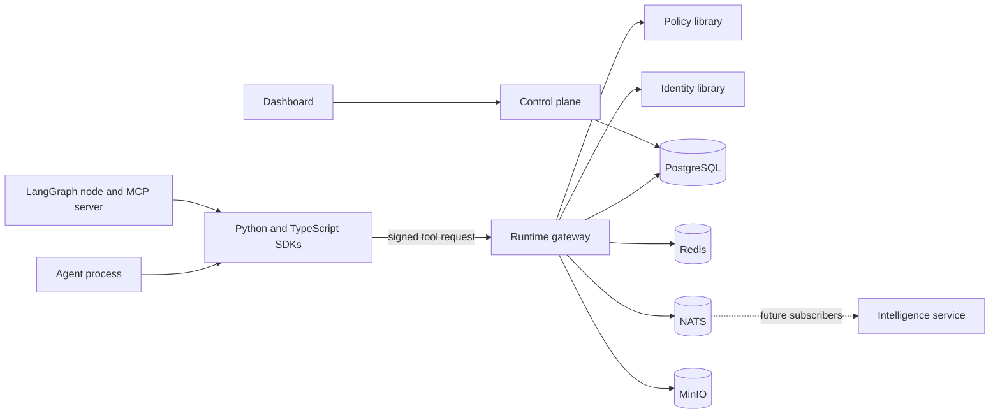

# Architecture

AgentShield is a security and reliability layer in front of tools used by autonomous agents. Agents do not decide whether their own tool calls are allowed. A gateway outside the agent runtime does.

This revision authorizes a signed tool call, lets a human approve or reject a pending request, and offers Python and TypeScript clients for that call. LangGraph and MCP can forward a tool call through those clients. They cannot run a tool themselves.

## System context

The dotted intelligence path is not wired. NATS is running for local development so the later event path has a broker. Nothing publishes to it yet.

## Services

| Service | Language | Owns | Does not own |
| --- | --- | --- | --- |
| Control plane (`apps/control-plane`) | NestJS | Users, organizations, memberships, agent registration, policy documents, human approval decisions | Hot-path authorization |
| Runtime gateway (`runtime/gateway`) | Go | Request authentication, policy evaluation, rate and budget enforcement, decision records, audit append | User accounts |
| Policy library (`runtime/policy-engine`) | Go | Deterministic evaluation, in-process | Network hops, storage |
| Identity library (`runtime/identity`) | Go | Signature input and Ed25519 verify | Nonce storage, key custody |
| Intelligence (`apps/intelligence-engine`) | Python | Later: injection and anomaly classification | Authorization decisions |
| Dashboard (`apps/dashboard`) | Next.js | Operator console | Enforcement |

The policy library is a package, not a service. Evaluation stays in the gateway process so a network failure cannot be confused with an allow.

The Python and TypeScript SDKs sign the raw body and send it to the gateway. The LangGraph node and the MCP server call that client. LangChain and CrewAI are still unsupported and do not intercept tool calls.

## Trust boundary

The agent process is untrusted. Claims in a JSON body, including organization id, permissions, and "this action was already approved", are not authority. The gateway will load the agent by the key that verifies the raw body, then load that agent's organization from PostgreSQL.

Human operators use the control plane. An agent credential cannot call approval routes. An agent cannot approve its own action.

## Data ownership

PostgreSQL is the transactional source of truth. Redis is reserved for nonces, rate limits, and short-lived approval state. NATS carries events after they are committed. MinIO stores evidence objects. The bucket created by Compose is private.

`policy_versions` is the authorization source. `agent_permissions` is a projection for display and must be written in the same transaction as a policy activation. Evaluators must not read that projection.

ClickHouse is not part of this revision. There is no event pipeline to justify it.

## Request path, target behavior

Phase 1 implements this path. It is recorded here so the gateway does not grow a second one.

1. Reject a body above the configured limit.
2. Verify the Ed25519 signature over the raw body, timestamp, and nonce.
3. Reject a reused nonce and a timestamp outside 60 seconds.
4. Load the agent and active credential. Deny unless status is active and the organization claim matches.
5. Load the active organization policy and the active agent policy.
6. Evaluate with the rules in ADR 0004.
7. Apply the Redis request, tool-call, and token budgets. A breach stops before a decision is stored.
8. Persist the invocation and the decision, and append the audit link, in one transaction.
9. `allow` may be executed by a registered adapter. `deny` stops. `require_approval` persists an approval bound to the raw-body hash and stops until a human approves it. Execute then consumes that approval once.
10. On any error, do not call the tool.

`sample.echo` is the only registered adapter. It returns the operation and resource and does not call another system. An unknown tool is HTTP 501, not a fake success.

## Repository layout

`apps/` holds long-running services. `runtime/` holds the gateway and the libraries on its hot path. `docs/api/` is the contract. `infrastructure/docker/postgres/migrations/` is the schema source of truth. Application code must not create or alter tables outside those migrations.

## What runs today

The control plane registers agents, rotates and revokes their keys, records human approval decisions, and lists incidents for an owner, admin, or auditor. The gateway verifies Ed25519 signatures, reserves nonces in Redis, applies request, tool-call, and token budgets, evaluates allow, deny, and require_approval, and appends the audit chain. Oversized arguments and a burst of denies open incidents without changing the policy outcome. An approved `sample.echo` call can be consumed once, with a two-second adapter deadline and a circuit that opens after repeated adapter failures. That adapter has no external side effect. Python and TypeScript clients, a LangGraph node, and an MCP server send calls to that gateway and do not execute tools themselves. Readiness is 200 only when the dependencies for that process answer. An owner or admin can run a catalog chaos scenario, and a missing observation is stored as a failure. The dashboard loads live agents, incidents, events, and audit links after sign-in and can export an audit head copy. Production configuration requires the `agentshield_app` database role.
